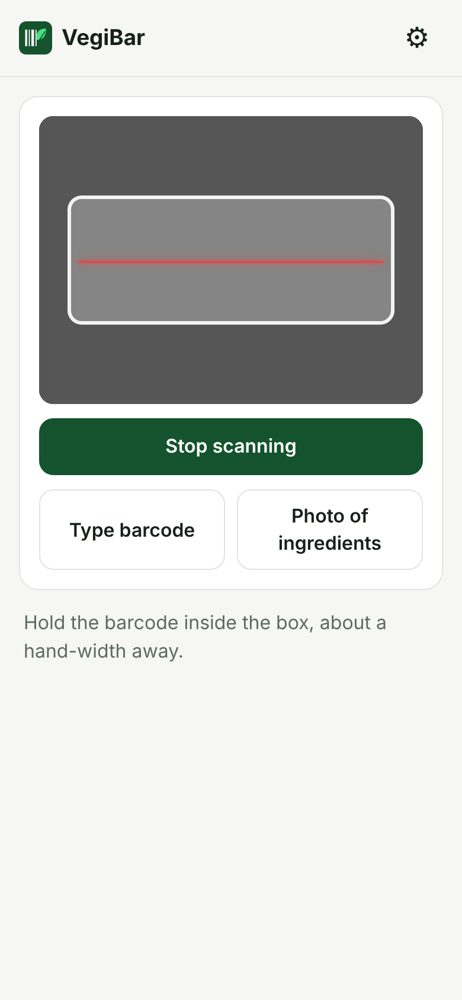
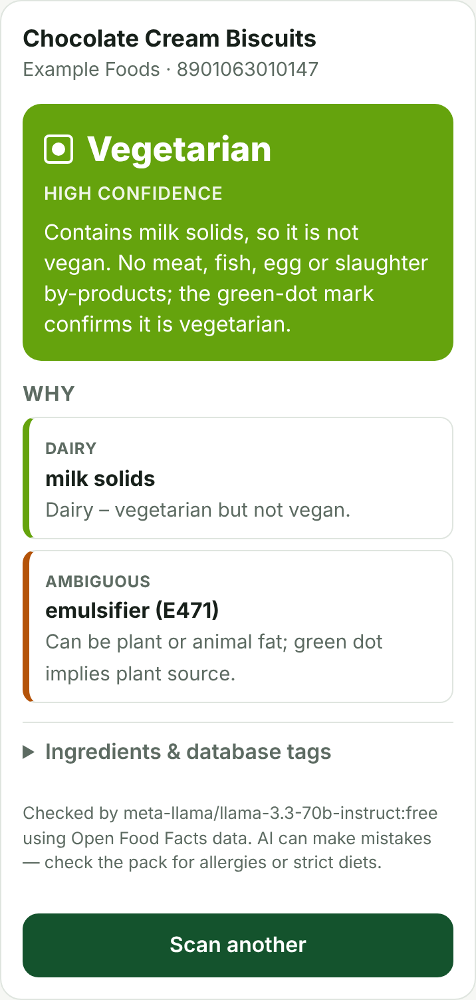

# VegiBar

**Scan a food barcode with your phone and find out if it's vegan, vegetarian or non‑veg, and why.**

VegiBar looks up the product's ingredient list and has a free AI model check every
ingredient. The verdict names the ingredients that decided it, and additives that
could come from either plants or animals (like E471) are flagged instead of
silently ignored.

**Live app:** https://tcookie47.github.io/VegiBar/

<p align="center">
  
  &nbsp;&nbsp;
  
</p>

## Features

- **Barcode scanning in the browser.** Works on iPhone and Android, with a
  flashlight toggle for dim shops. You can also type the number in.
- **A verdict with reasons.** Vegan, Vegetarian, Non‑veg or Not sure, a
  confidence level, a short justification, and a "Why" list of each
  animal-derived or ambiguous ingredient.
- **Photo fallback.** If the product isn't in the database, take a photo of
  the ingredient panel and an AI vision model reads it. You can also paste
  the ingredients as text.
- **Indian or Western convention.** Eggs count as non‑veg by default, and you
  can change that in settings. Indian green/brown dot marks are used as
  evidence when the database has them.
- **Nutrition at a glance.** Nutri‑Score and NOVA processing badges, plus a
  per‑100 g nutrition table (energy, fat, sugar, protein, salt…) from Open Food Facts.
- **Instant repeat scans.** Results are saved on the phone for 30 days, so
  scanning something again shows the answer immediately, with no network or
  AI call. Tap **Re-check** for a fresh lookup.
- **Recent scans** are kept on the phone so you can look them up again.
- **No backend and no account.** It's three static files, free to host on
  GitHub Pages, and can be added to your home screen like an app.

## Getting started

1. Create a free API key at **https://openrouter.ai/keys**. Free models cost
   nothing; set a small credit limit on the key anyway as a precaution.
2. Open the [live app](https://tcookie47.github.io/VegiBar/) on your phone.
3. Tap **⚙︎**, paste the key and tap **Save**.
4. Tap **Scan barcode**, allow the camera, and hold the barcode inside the box
   about a hand's width away.

To make it feel like an app, add it to your home screen: **Share → Add to Home
Screen** on iPhone, or **⋮ → Add to Home screen** on Android.

## Your API key

The key is saved on your phone in the browser's local storage, so **you enter it
once and it is remembered** each time you open the app. It is only ever sent to
`openrouter.ai`, never to anywhere else.

A few things to know:

- **Home-screen app vs. browser:** on iPhone, the home-screen app has its own
  storage, separate from Safari. If you saved the key in Safari before adding
  the app, enter it once more inside the home-screen app.
- **The key is forgotten if** you clear the browser's website data, use a
  private tab, or delete the home-screen app.
- **Each device is separate.** Your laptop and phone each need the key entered once.

## How it works

```
camera ──► barcode ──► Open Food Facts ──► ingredients + labels ──► OpenRouter LLM ──► verdict
                            │ not found / no ingredients
                            └──► photo of label ──► OpenRouter vision LLM ──► verdict
```

| Step | What it uses |
|---|---|
| Scan | 1080p camera with continuous autofocus. The phone's built-in `BarcodeDetector` is used on Android Chrome, and the [barcode-detector](https://github.com/Sec-ant/barcode-detector) ZXing‑C++ WebAssembly decoder everywhere else (iPhone Safari, Firefox). |
| Product data | [Open Food Facts](https://world.openfoodfacts.org) provides the name, brand, ingredients, vegan/vegetarian analysis tags, labels and allergens. It is free and needs no key. |
| Cache | Finished results are saved in the browser's local storage, keyed by barcode: up to 500 products for 30 days. Entries made under a different egg setting are ignored. **⚙︎ → Clear saved data** wipes the cache and history. |
| Reasoning | An [OpenRouter](https://openrouter.ai) chat model returns JSON with the verdict, confidence, a summary and the flagged ingredients. |

### Product coverage

Open Food Facts is a crowd-sourced database with excellent coverage in Europe and
patchier coverage elsewhere, including India. When a product is missing, VegiBar
offers the photo and paste fallbacks. You can also add the product yourself with
the free Open Food Facts mobile app. It then becomes available to everyone,
including VegiBar.

## Settings

| Setting | Default | Notes |
|---|---|---|
| OpenRouter API key | — | Required. Stored only on the device. |
| Model | `openrouter/free` | Any OpenRouter model ID. Free ones end in `:free`. If the chosen model fails or is rate-limited, the free fallbacks in `FALLBACK_MODELS` (text) and `VISION_FALLBACK_MODELS` (photos) at the top of `app.js` are tried in order. |
| Eggs count as | Non‑veg | Switch to Vegetarian for the Western lacto‑ovo convention. |

## Running and deploying

Pushing to `main` deploys to GitHub Pages using
[`.github/workflows/pages.yml`](.github/workflows/pages.yml). On a fresh fork,
first set **Settings → Pages → Source** to **GitHub Actions**.

To run it locally (the camera works on `localhost`):

```sh
python3 -m http.server 8000
# then open http://localhost:8000
```

Phones need **HTTPS** for the camera. To try local changes on a phone, use a
tunnel such as `cloudflared tunnel --url http://localhost:8000`.

### Project layout

```
index.html              page markup and settings dialog
app.js                  scanner, Open Food Facts lookup, OpenRouter calls, rendering, history
styles.css              mobile-first styles with light and dark mode
manifest.webmanifest    "Add to Home Screen" metadata
icon.svg                app icon
docs/                   README screenshots
```

There is no build step and no `npm install`. The only third-party script is
`barcode-detector`, loaded from jsDelivr at a pinned version.

## Limitations

- **AI can be wrong.** Always check the pack if you have an allergy or follow a
  strict religious diet.
- **Some ingredients really are ambiguous.** "Natural flavours", E471, enzymes,
  whey (from rennet) and vitamin D3 can come from plants or animals. VegiBar
  flags them and lowers its confidence rather than guessing silently.
- **Database entries can be incomplete or out of date.** Recipes change. When in
  doubt, use the photo option on the pack in your hand.
- **Free models are rate-limited** by OpenRouter and are sometimes busy. The
  app tries every fallback model, then waits and retries (after 3 s and 8 s)
  before giving up with a short error and a **Try again** button. A rejected
  API key stops straight away.

## Credits

Product data © [Open Food Facts](https://world.openfoodfacts.org) contributors,
under the [Open Database License](https://opendatacommons.org/licenses/odbl/1-0/).
Barcode decoding by [barcode-detector](https://github.com/Sec-ant/barcode-detector)
and [zxing-wasm](https://github.com/Sec-ant/zxing-wasm).
